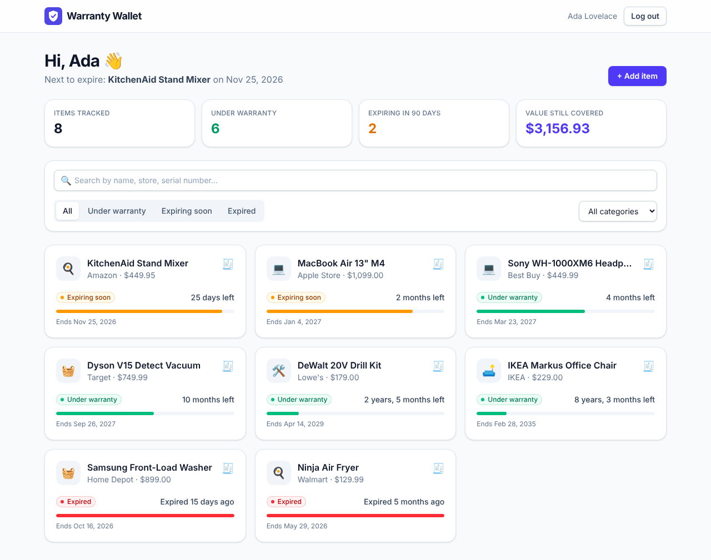
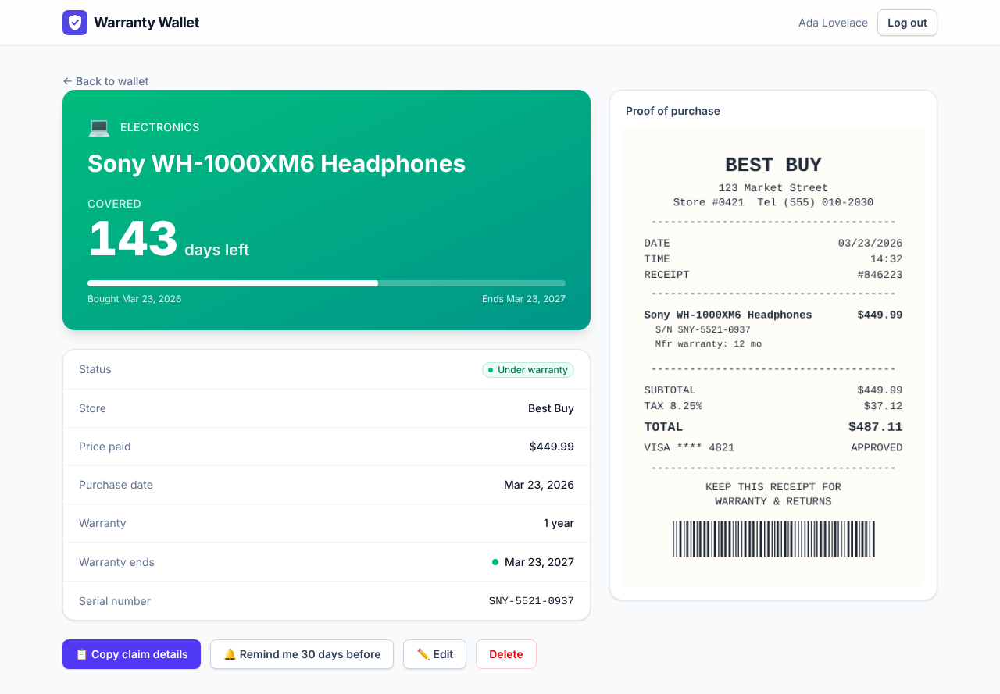

# 🛡️ Warranty Wallet

**Never lose a receipt. Never miss a warranty.**

Warranty Wallet keeps every receipt in one place and shows exactly how long each warranty has left. When something breaks, you know in seconds whether it's covered, with the proof of purchase ready to show the store.

Built for the **Appwrite Databases Hackathon** on **Appwrite TablesDB**.



## The problem

People buy things with 1–3 year warranties, then lose the paper receipt or forget the warranty exists. When the product breaks they either can't prove the purchase or find out coverage ended last month, and they pay for a repair that should have been free.

## What it does

- **Add an item in seconds:** name, store, price, purchase date and warranty length (one-tap presets for 90 days, 1, 2, 3 or 5 years).
- **Snap the receipt:** take a photo or upload an image/PDF. It's stored privately in Appwrite Storage.
- **Dashboard sorted by urgency:** every item gets a badge.
  - 🟢 **Under warranty:** more than 90 days left
  - 🟡 **Expiring soon:** 90 days or less
  - 🔴 **Expired**
- **Live stats:** items tracked, items still covered, items expiring soon, and the total value still under warranty.
- **Search and filter** by name, store, serial number, category or status.
- **Item page:** a large "days left" countdown next to the receipt, so it's the screen you show at the service desk.
- **Copy claim details:** one tap copies product, serial number, store, purchase date, price and warranty end date for a support email or claim form.
- **Calendar reminder:** downloads an `.ics` event 30 days before the warranty ends, for Google Calendar, Apple Calendar or Outlook.
- **Sample data:** one click fills a new account with 8 realistic items, each with a generated receipt image.
- Works on mobile. The upload button opens the camera on phones.



## How it uses Appwrite

| Appwrite product | Used for |
|---|---|
| **TablesDB** | The `items` table holds every purchase. The dashboard is a single TablesDB query: `Query.equal('userId', …)` + `Query.orderAsc('warrantyEndsAt')`, backed by a composite index. |
| **Storage** | Private `receipts` bucket (encrypted, antivirus scanned, 10 MB limit, images and PDFs only). |
| **Auth** | Email/password accounts and sessions. |
| **Permissions** | Row security and file security are on. Each row and receipt is readable and editable only by the user who created it. |

### Data model: `items` table

| Column | Type | Notes |
|---|---|---|
| `name` | varchar(128), required | |
| `store` | varchar(128) | |
| `category` | enum | Electronics, Appliances, Kitchen, Furniture, Tools, Vehicles, Other |
| `purchaseDate` | datetime, required | |
| `warrantyMonths` | integer, required | 0–600 |
| `warrantyEndsAt` | datetime, required | Calculated on save so TablesDB can sort and filter by expiry |
| `price` | float | |
| `serialNumber` | varchar(128) | |
| `notes` | text | |
| `receiptFileId` | varchar(64) | ID of the file in the `receipts` bucket |
| `userId` | varchar(64), required | Owner |

**Index:** `idx_user_expiry` on (`userId` ASC, `warrantyEndsAt` ASC).

Everything above is created by one script, `scripts/setup.ts`, so the whole backend is reproducible.

## Tech stack

React 19 · TypeScript · Vite · Tailwind CSS v4 · React Router · Appwrite Web SDK · Appwrite Node SDK (setup script)

## Run it yourself

### 1. Create an Appwrite project

1. Sign in at [cloud.appwrite.io](https://cloud.appwrite.io) and create a project.
2. **Add a Web platform:** Overview → Add platform → Web. Use hostname `localhost` (add your deployed domain later too).
3. **Create an API key:** Overview → Integrations → API keys. Give it the `databases`, `tables`, `columns`, `indexes` and `buckets` read and write scopes. This key is only used by the setup script.

### 2. Configure and set up

```bash
git clone <your-repo-url> warranty-wallet
cd warranty-wallet
npm install
cp .env.example .env
```

Fill in `.env` with your endpoint (shown in Settings in the Appwrite Console), project ID and API key. Then:

```bash
npm run setup
```

This creates the database, the `items` table with its columns and index, and the `receipts` bucket. It's safe to run more than once.

### 3. Start the app

```bash
npm run dev
```

Open http://localhost:5173, sign up, and click **Load sample items** to try it with realistic data.

## Deploy

Any static host works. Build command `npm run build`, output folder `dist`.

Set these environment variables on the host (do **not** add the API key there):

```
VITE_APPWRITE_ENDPOINT
VITE_APPWRITE_PROJECT_ID
VITE_APPWRITE_DATABASE_ID=warranty_wallet
VITE_APPWRITE_TABLE_ID=items
VITE_APPWRITE_BUCKET_ID=receipts
```

Then add the deployed domain as a Web platform in your Appwrite project. A `public/_redirects` file is included so page refreshes work on single-page app hosts.

## Project structure

```
scripts/setup.ts          Creates the TablesDB database, table, columns, index and Storage bucket
src/lib/appwrite.ts       Appwrite client
src/lib/items.ts          TablesDB queries and Storage uploads
src/lib/warranty.ts       Warranty date maths (end date, days left, status)
src/lib/auth.tsx          Login, signup and session state
src/lib/calendar.ts       .ics reminder export
src/lib/sampleData.ts     Demo items with generated receipt images
src/pages/                Dashboard, item detail, add/edit, login
src/components/           Form, status badge, receipt viewer, layout
```

## What's next

- Scheduled Appwrite Function that emails users 30 days before a warranty ends
- Read the store, date and price from the receipt photo automatically
- Shared household wallets using Appwrite Teams

## License

MIT
